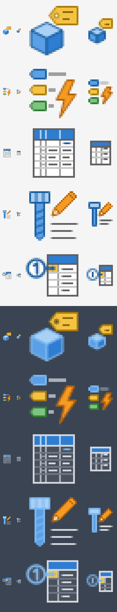
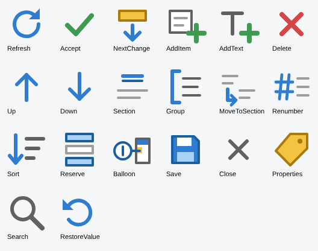

# Значки кнопок

Исходники — SVG в `src/`, отдельно для 16 и 32 px (линии выровнены по пиксельной сетке каждого размера).

| Значок | Команда |
|---|---|
| `assign-section` | Раздел |
| `auto-assign` | Авторазделы |
| `standard-names` | Имя из файла |
| `specification` | Спецификация |
| `write-positions` | Позиции в BOM |

Палитра: синий `#2E7DD1` / `#5AA0E6` / `#A9D0F5` с контуром `#1C5F9E`, жёлтый `#F5C342`, оранжевый `#F59B23`,
зелёный `#7CC47F`, нейтральные `#616161`, `#9E9E9E`, `#C7C7C7`, бумага `#FFFFFF`.
Для тёмной темы Inventor нейтральные цвета и синий контур заменяются автоматически (см. `darkPalette` в `render.js`).

## Конвертация

```
node resources/icons/render.js [папка для превью]
```

Нужны Node.js и Playwright с Chromium. Скрипт создаёт `src/InventorGostSpec.AddIn/Resources/Icons/<имя>-<размер>[-dark].png`,
которые встраиваются в аддин. PNG лежат в репозитории, поэтому для сборки аддина конвертация не нужна —
только после правки SVG.



## Значки окон

Значки панели команд окон (16×16) описаны в `ui_icons.py` — одно описание даёт XAML-ресурсы
`src/InventorGostSpec.UI/Themes/Icons.xaml` (ключи `Icon.<Имя>`) и SVG для предпросмотра:

```
python3 resources/icons/ui_icons.py [папка для превью]
```

